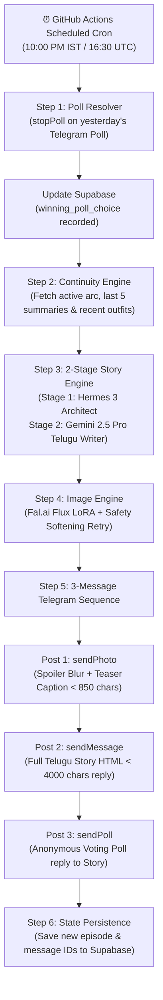

# Maya Telugu Vlog (`maya-telugu-vlog`)

> **Autonomous Daily Telugu Storytelling & Character Visual Pipeline on Telegram**  
> An automated, production-grade interactive fiction engine that delivers a daily episode of **"Maya's Life"** — an addictive, sensual, romantic first-person vlog series written in authentic spoken colloquial Telugu (వ్యావహారిక తెలుగు mixed naturally with modern urban English), accompanied by character-consistent photorealistic vertical imagery.

---

## 🌟 Architecture & Sequence Overview

Every night at **10:00 PM IST (16:30 UTC)**, the pipeline automatically executes the following 6-step workflow:



---

## 📱 Telegram 3-Message Subscriber Journey

To maximize click-through rate, dwell time, and viral engagement, each episode is structured as an interactive 3-part sequence:

1. **Post 1: Photorealistic Glamour Image (`sendPhoto`)**:
   - Sent with **Telegram Spoiler Blur** (`has_spoiler=true`), compelling subscribers to tap to unblur.
   - Caption contains an intense, breathless **Teaser Hook** (`teaser_caption_te` < 850 chars) that cuts off right at the peak of romantic tension, concluding with:
     ```
     👇 పూర్తి స్టోరీ కింద మెసేజ్లో చదవండి...
     ```
2. **Post 2: Full Story Chapter (`sendMessage`)**:
   - Sent as an immediate direct reply to Post 1.
   - Formatted in intimate, late-night first-person colloquial Telugu (2,000–3,000 characters) with short paragraphs and Telegram-safe HTML (`<b>`, `<i>`).
   - Automatically split on clean paragraph boundaries (`\n\n`) if it ever exceeds Telegram's 4,000 character limit.
3. **Post 3: Interactive Decision Poll (`sendPoll`)**:
   - Sent as a direct reply to Post 2.
   - Spicy dilemma asking subscribers what daring move Maya should make tomorrow night (`is_anonymous=true`).
   - The winning choice is retrieved 24 hours later by `poll_resolver.py` and directly dictates the plot of the next episode!

---

## 🔒 Character Persona & Telegram Ban Protection

All prompt crafting and narrative generation adheres strictly to the character bible in [`.agents/rules/maya-persona-and-safety.md`](.agents/rules/maya-persona-and-safety.md):

- **Persona**: Maya (మాయ), 24-year-old independent fashion curator living in an 18th-floor luxury penthouse in Jubilee Hills, Hyderabad. Expressive dark eyes, long wavy jet-black hair, warm honey-bronze South Indian complexion, and curvy athletic hourglass silhouette.
- **Platform Safety Guardrail**:
  - **Zero Explicit Nudity**: Strictly prohibits exposed genitalia, nipples, or pornographic acts to guarantee the channel never encounters iOS/Android App Store `PORNOGRAPHY` restrictions or bans.
  - **Maximum Glamour & Boudoir Sensuality**: Explores wet monsoon georgette sarees with deep backless designer blouses, silk slip dresses with delicate straps, satin nightwear, golden-hour amber rim lighting, and rain-streaked penthouse glass balcony reflections.
  - **Automatic Prompt-Softening Retry**: If Fal.ai flags or fails a prompt, the engine automatically replaces sensitive terms with high-fashion equivalents and retries once so the cron job never crashes.

---

## 📂 Repository Structure

```
maya-telugu-vlog/
├── .agents/rules/maya-persona-and-safety.md  # Canonical character bible & visual safety rules
├── .github/workflows/daily_maya_post.yml     # Automated nightly GitHub Actions cron workflow
├── supabase/migrations/001_initial_schema.sql # PostgreSQL DDL tables (story_arcs, episodes) & seed data
├── src/
│   ├── __init__.py
│   ├── config.py            # Pydantic BaseSettings v2 loading all .env variables
│   ├── db.py                # Supabase repository with graceful in-memory mock fallback
│   ├── poll_resolver.py     # Stops yesterday's Telegram poll, determines winning choice, updates DB
│   ├── story_engine.py      # 2-stage LLM pipeline (Hermes 3 Architect + Gemini 2.5 Pro Telugu Writer)
│   ├── image_engine.py      # Fal.ai Flux LoRA integration with 1-time prompt-softening retry
│   ├── telegram_publisher.py# Async httpx Telegram Bot wrapper (sendPhoto, sendMessage, sendPoll, stopPoll)
│   └── main.py              # CLI entrypoint supporting `--dry-run` (HTML preview) and `--live`
├── tests/
│   └── test_pipeline_mock.py# Pytest test suite mocking all external APIs with 100% pass rate
├── .env.example             # Complete environment variables template
├── pyproject.toml           # uv and modern Python packaging configuration
├── requirements.txt         # Standard requirements file for GitHub Actions / CI
└── README.md                # Full documentation & setup guide
```

---

## 🛠️ Quickstart & Local Setup

### 1. Prerequisites
- Python 3.11+ (recommended: Python 3.12)
- [`uv`](https://docs.astral.sh/uv/) (fast Python package manager) or standard `pip`

### 2. Clone & Install Dependencies

Using `uv`:
```bash
git clone https://github.com/your-username/maya-telugu-vlog.git
cd maya-telugu-vlog
uv sync
```

Or using standard `pip`:
```bash
python -m venv .venv
source .venv/bin/activate  # On Windows: .venv\Scripts\activate
pip install -r requirements.txt
```

### 3. Configure Environment Variables

Copy `.env.example` to `.env`:
```bash
cp .env.example .env
```

#### 💡 100% Zero-Cost Tier Configuration (Zero Dollars, No Credit Card Required):
```ini
# OpenRouter Free Models (OpenRouter API keys are free to generate with 0 credits)
OPENROUTER_API_KEY=sk-or-v1-...
STORY_ARCHITECT_MODEL=meta-llama/llama-3.3-70b-instruct:free
TELUGU_WRITER_MODEL=google/gemini-2.0-flash-exp:free

# Image Generation via Pollinations.ai (100% Free Flux engine, NO API key needed!)
IMAGE_PROVIDER=pollinations

# Supabase (Free Tier: 500MB DB, 50k MAU - $0.00 forever)
SUPABASE_URL=https://your-project.supabase.co
SUPABASE_SERVICE_KEY=eyJhbGciOi...

# Telegram Bot (Free API, $0.00 forever)
TELEGRAM_BOT_TOKEN=123456789:ABCdef...
TELEGRAM_CHANNEL_ID=@your_channel_name
TELEGRAM_SPOILER_BLUR=true
```

#### Optional Premium Mode (Fal.ai Flux LoRA):
```ini
IMAGE_PROVIDER=fal
FAL_KEY=your_fal_api_key_here
FAL_LORA_URL=https://huggingface.co/XLabs-AI/flux-lora-collection/resolve/main/flux-realism-lora.safetensors
```

---

## 🧪 Testing & Verification

Run the comprehensive mock test suite:
```bash
pytest tests/test_pipeline_mock.py -v
```

All tests mock OpenRouter, Fal.ai, Supabase, and Telegram APIs to verify:
- Poll tally calculation and winning choice resolution.
- 2-stage Story Engine generation and Pydantic v2 `EpisodePayload` validation.
- Long text paragraph splitting (< 4000 chars) for Telegram.
- Image prompt builder and safety softening logic.
- End-to-end dry-run HTML preview generation.

---

## 🖥️ Running the Pipeline

### Local Dry-Run (Browser Preview)
To test the pipeline locally without publishing to Telegram or requiring external API keys:
```bash
python -m src.main --dry-run
```
This generates:
1. `preview_output.html`: An interactive dark-mode Telegram channel simulation where you can click to unblur Maya's photo, read the formatted Telugu story, and review the interactive poll.
2. `preview_image.jpg`: The generated vertical portrait.

Open `preview_output.html` in your browser:
```bash
# On Windows
start preview_output.html

# On macOS
open preview_output.html

# On Linux
xdg-open preview_output.html
```

### Live Publishing Run
When your `.env` contains valid credentials and you want to publish the daily episode:
```bash
python -m src.main --live
```

---

## 🗄️ Supabase Database Setup

1. Log into your [Supabase Dashboard](https://supabase.com).
2. Open the **SQL Editor**.
3. Copy and run the contents of [`supabase/migrations/001_initial_schema.sql`](supabase/migrations/001_initial_schema.sql).
4. This creates:
   - `story_arcs`: Tracks active storyline arcs, settings, characters, and tension level.
   - `episodes`: Stores full Telugu scripts, teaser captions, English memory summaries, outfit history, image URLs, and Telegram message IDs.
   - Row 1 Seed: Maya moving into her Jubilee Hills luxury penthouse opposite photographer Vikram.

---

## 🤖 Telegram Bot Configuration

1. Create a bot with [@BotFather](https://t.me/BotFather) and copy your **Bot Token**.
2. Create your public or private Telegram Channel.
3. Add your bot as an **Administrator** in the channel with permissions:
   - *Post Messages*
   - *Edit Messages*
   - *Delete Messages*
4. Put the channel username (e.g. `@maya_telugu_diary`) or numerical chat ID into `TELEGRAM_CHANNEL_ID`.

---

## ⏰ Automated Nightly Deployment (GitHub Actions)

The included workflow [`.github/workflows/daily_maya_post.yml`](.github/workflows/daily_maya_post.yml) runs every night at **10:00 PM IST**:

1. Push this repository to GitHub.
2. Go to **Settings > Secrets and variables > Actions**.
3. Add the following **Repository Secrets**:
   - `OPENROUTER_API_KEY`
   - `FAL_KEY`
   - `SUPABASE_URL`
   - `SUPABASE_SERVICE_KEY`
   - `TELEGRAM_BOT_TOKEN`
   - `TELEGRAM_CHANNEL_ID`
4. (Optional) Under **Variables**, customize `STORY_ARCHITECT_MODEL` or `TELUGU_WRITER_MODEL`.
5. You can trigger manual test runs anytime from the **Actions** tab with the `dry_run` toggle!
